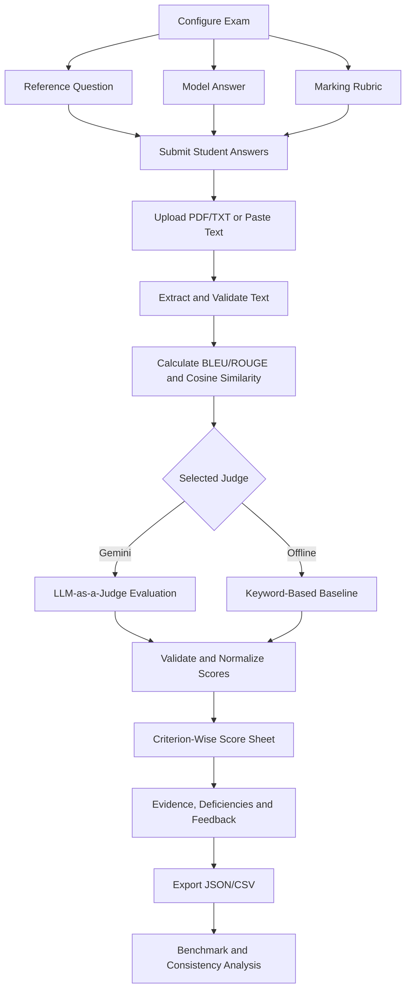

# 🎓 ExamJudge — Automated Descriptive Exam Assessment Engine

**Rubric-based descriptive answer evaluation using Google Gemini and an LLM-as-a-Judge approach.**

[🚀 Live Demo](https://examjudge.streamlit.app/) · [💻 GitHub Repository](https://github.com/swapnil-kumar06/ExamJudge)

ExamJudge is a Python and Streamlit application that evaluates descriptive examination answers against a reference question, model answer, and configurable multi-criteria marking rubric.

It generates criterion-wise scores, evidence from student responses, conceptual deficiencies, strengths, and constructive feedback. The application also calculates text-similarity metrics and includes tools for benchmark comparison and grading consistency analysis.

> **Academic project:** ExamJudge is intended to support evaluation and experimentation. Its marks are estimates and should be reviewed by a human evaluator before consequential academic decisions.

---

## 📌 Problem Statement

Manual evaluation of long-form university examination answers is time-consuming and may vary between evaluators. Simple text matching is also insufficient because students can express the same correct concept using different wording.

ExamJudge addresses this problem by combining rubric-based LLM evaluation with automated text-similarity metrics. The aim is to make descriptive answer assessment more structured, explainable, and auditable.

## ✨ Features

### 📝 1. Exam Setup and Custom Rubrics
- Enter a reference question and model answer.
- Create and edit multiple marking criteria.
- Specify maximum marks and descriptions for each criterion.
- Load a sample examination configuration with one click.
- Validate rubric entries and calculate the total possible marks.

### 🤖 2. LLM-as-a-Judge Evaluation
- Uses Google Gemini through Google's OpenAI-compatible API endpoint.
- Supplies the question, model answer, marking criteria, and student response to the evaluator.
- Sends judge requests with temperature `0.0` to reduce sampling variability; hosted-model outputs are not guaranteed to be identical across calls.
- Supports few-shot calibration examples.
- Produces criterion-wise marks and concise grading rationales.
- Identifies supporting evidence, conceptual deficiencies, strengths, and improvement feedback.
- Validates the returned structure, clamps scores to permitted ranges, rounds scores to half-mark increments, and recalculates totals in code.

### 📄 3. Student Answer Processing
- Upload multiple PDF or TXT files in one grading run.
- Paste a student response directly into the dashboard.
- Extract text from supported documents.
- Grade uploaded answers individually against the same exam configuration.
- Apply configured file-size, PDF-page, text-length, and batch limits.

### 📊 4. Automated Text-Similarity Metrics

ExamJudge calculates supplementary metrics comparing student answers with the model answer:

| Metric | Purpose |
|---|---|
| BLEU | Measures n-gram overlap |
| ROUGE-1 | Measures unigram overlap |
| ROUGE-2 | Measures bigram overlap |
| ROUGE-L | Measures longest-common-subsequence overlap |
| ROUGE-L Recall | Measures reference-text coverage |
| Cosine similarity | Estimates text similarity using vector representations |

The project uses the Hugging Face `evaluate` library where available and includes fallback implementations.

These metrics are supplementary indicators, not direct measures of conceptual correctness or grading accuracy.

The option to include BLEU/ROUGE values in the judge prompt is disabled by default to reduce the risk of the judge over-relying on lexical similarity.

### 📋 5. Structured Results and Exports
Each assessment can include:
- Criterion-wise marks and maximum marks.
- Grading explanations and supporting evidence.
- Missing concepts and conceptual deficiencies.
- Identified strengths.
- Constructive improvement feedback.
- BLEU, ROUGE, and cosine similarity results.
- Warnings associated with score normalization or evaluation.

Supported exports include JSON score sheets, CSV results, and Markdown benchmark or analysis reports.

### 🧪 6. Benchmark Against Human Grades
The **Benchmark vs human** tab compares automated marks with independently assigned human marks for five answers. It uses the same active question, model answer, and rubric entered in **Grade answers**. The app does not prefill or default to illustrative benchmark grades.

The formal CSV workflow calculates:
- Mean Absolute Error (MAE) and Root Mean Squared Error (RMSE).
- Pearson and Spearman correlations where mathematically defined.
- Mean signed error to assess over- or under-grading.
- Percentage within 0.5 and 1.0 marks of the human reference.
- Per-criterion absolute errors and BLEU/ROUGE correlations with reference totals.

**Important:** bundled answer files and marks are test fixtures only. The formal benchmark requires five complete answers and criterion-level marks supplied by a human evaluator. A checkbox attestation is not independent verification, and five answers do not establish broad grading accuracy.

### ⚖️ 7. Bias and Consistency Analysis
The Bias & Consistency tab includes checks for:

- **Repeatability:** compares scores across repeated evaluations.
- **Criterion-order invariance:** compares original, reversed, and shuffled rubric orderings.
- **Verbosity bias:** tests whether irrelevant filler changes an answer's score.
- **Position consistency:** compares pairwise judgments when answer order is reversed.
- **Length-score correlation:** compares answer length with automated and reference scores.

These checks help investigate potential issues. Results from the offline baseline must not be presented as proof of LLM reliability.

### 📚 8. Prompt Templates and Calibration
The project includes evaluator prompts, few-shot scoring examples, calibration criteria, and a pairwise comparison prompt.

These files document how the evaluator is instructed to apply the rubric, treat student answers as untrusted input, and return structured assessment results.

### 🔐 9. Security and Resource Controls
- Reads Gemini credentials from server-side Streamlit Secrets or environment variables.
- Does not expose the configured Gemini API key in the normal application interface.
- Requires a shared application password when a server-side Gemini key is configured.
- Keeps the Gemini API endpoint and model configuration under server control.
- Applies a per-session estimated API-call limit.
- Limits upload size, PDF pages, batch size, and prompt input lengths.
- Includes guidance for safe secret handling and deployment.

These are basic safeguards, not enterprise-grade authentication or global rate limiting.

---

## 🔄 System Workflow



### Workflow explanation

1. **Exam configuration:** The evaluator enters the question, model answer, and marking rubric.
2. **Answer submission:** Student answers are uploaded as PDF/TXT files or pasted into the interface.
3. **Text extraction and validation:** Supported files are checked against configured limits, and their text is extracted.
4. **Similarity calculation:** BLEU, ROUGE, and cosine similarity are calculated as supplementary comparison metrics.
5. **Grading:** Gemini evaluates the response against the rubric, or the offline keyword baseline provides a basic demonstration score.
6. **Result normalization:** Criterion scores are checked against permitted limits and the total is recomputed.
7. **Feedback generation:** The application presents criterion-wise scores, evidence, deficiencies, strengths, and improvement suggestions.
8. **Export and analysis:** Results can be downloaded and used in benchmark or consistency checks.

---

## 🛠️ Technology Stack

| Component | Technology |
|---|---|
| Programming language | Python |
| User interface | Streamlit |
| LLM evaluator | Google Gemini API |
| LLM client | OpenAI-compatible Python client |
| PDF processing | PyMuPDF |
| Text-similarity metrics | Hugging Face `evaluate`, ROUGE and BLEU implementations |
| Data handling | Pandas, NumPy |
| Assessment output | JSON, CSV, Markdown |
| Testing | Pytest |
| Deployment | Streamlit Community Cloud |

---

## 🏗️ Project Structure

```text
ExamJudge/
├── app.py
├── requirements.txt
├── requirements-dev.txt
├── Dockerfile
├── DEPLOYMENT.md
├── SECURITY.md
├── README.md
│
├── engine/
│   ├── judge.py
│   ├── llm_client.py
│   ├── prompts.py
│   ├── pdf_utils.py
│   ├── metrics.py
│   ├── rubric.py
│   ├── benchmark.py
│   ├── analysis.py
│   ├── reporting.py
│   └── stats.py
│
├── prompts/
│   ├── judge_system.md
│   ├── pairwise_system.md
│   ├── calibration.md
│   └── few_shot.json
│
├── data/
│   ├── sample/
│   │   ├── question.txt
│   │   ├── model_answer.txt
│   │   └── rubric.json
│   └── benchmark/
│       ├── README.md
│       ├── benchmark_template.csv
│       ├── human_grades.json   # illustrative only
│       └── student_answers/
│
├── reports/
│   ├── project_report.md
│   ├── benchmark_report.md
│   ├── bias_consistency_analysis.md
│   └── benchmark_scores.csv
│
├── scripts/
│   └── run_reports.py
│
├── tests/
│   └── test_engine.py
│
└── .streamlit/
    ├── config.toml
    └── secrets.toml.example
```

**Note:** The example above omits individual student-answer filenames for readability. The actual repository includes five sample answers in both TXT and PDF form.

---

## 🚀 Live Deployment

**Live application:** https://examjudge.streamlit.app/

ExamJudge is deployed through Streamlit Community Cloud.

The deployed app uses server-side Gemini credentials and a shared application password.

### Configure Streamlit Secrets

In Streamlit Community Cloud, open the app's settings and add the following under **Secrets**:

```toml
GEMINI_API_KEY = "your-gemini-api-key"
APP_PASSWORD = "your-strong-application-password"
GEMINI_MODEL = "your-supported-gemini-model"
```

Use a Gemini model currently available to your Google AI Studio API key.

Never commit real credentials to GitHub. The repository contains `secrets.toml.example` as a template; the real `.streamlit/secrets.toml` file must remain local and untracked.

For more information, see [DEPLOYMENT.md](DEPLOYMENT.md) and [SECURITY.md](SECURITY.md).

---

## 💻 Run Locally

### Choose one of two run modes (Windows)

**Option 1 — Local/offline demo, no Gemini key:** extract the project and double-click `run_local.bat`. It creates `.venv`, installs dependencies, and starts Streamlit with the Gemini environment variables cleared for that process. In the sidebar, select **Offline baseline**. This is a keyword heuristic for interface testing only, not reliable semantic grading. Internet access is needed for the initial package installation.

**Option 2 — Gemini LLM-as-a-Judge:** double-click `run_gemini.bat`, enter your Gemini API key and a local app password when prompted, then select **Google Gemini** in the sidebar. The script uses environment variables for that process and does not write the key to a file. Input may be visible while typing, so avoid shared computers. For repeatable setup or Streamlit Cloud, use `.streamlit/secrets.toml` or Streamlit Secrets and never commit secrets. The default model is `gemini-2.5-flash`; availability and quotas depend on your Google AI Studio account.

You can also launch either mode manually using the commands below. Temperature is fixed at 0.0, which reduces sampling variability but does not guarantee identical marks on every run.

### Prerequisites

- Python 3.11 recommended.
- Git.
- For Gemini mode only: a Google Gemini API key from [Google AI Studio](https://aistudio.google.com/apikey). Offline mode requires no API key.

### 1. Clone the repository

```bash
git clone https://github.com/swapnil-kumar06/ExamJudge.git
cd ExamJudge
```

### 2. Create a virtual environment

**Windows PowerShell:**

```powershell
py -3.11 -m venv .venv
.\.venv\Scripts\Activate.ps1
```

**macOS/Linux:**

```bash
python3 -m venv .venv
source .venv/bin/activate
```

### 3. Install dependencies

```bash
python -m pip install --upgrade pip
pip install -r requirements.txt
```

### 4. Configure local secrets

Copy the example file:

**Windows PowerShell:**

```powershell
Copy-Item .streamlit/secrets.toml.example .streamlit/secrets.toml
```

**macOS/Linux:**

```bash
cp .streamlit/secrets.toml.example .streamlit/secrets.toml
```

Edit `.streamlit/secrets.toml` and provide your own values:

```toml
GEMINI_API_KEY = "your-gemini-api-key"
APP_PASSWORD = "your-strong-application-password"
GEMINI_MODEL = "your-supported-gemini-model"
```

Do not commit the resulting `secrets.toml` file.

For an offline-only demonstration, the application can run without a Gemini key. Its keyword baseline is a weak heuristic and should not be used for consequential grading.

### 5. Start the application

```bash
streamlit run app.py
```

Open the local URL printed in the terminal, usually `http://localhost:8501`.

### 6. Try the sample examination

1. Unlock the application if prompted.
2. Click **Load sample exam**.
3. Review the sample question, model answer, and rubric.
4. Upload a sample student answer or paste text.
5. Click **Grade**.
6. Inspect the score sheet, evidence, feedback, and similarity metrics.
7. Export the result as JSON or CSV.

---

## 🧪 Testing

The repository includes automated tests for core grading and utility functionality.

Install the development dependencies:

```bash
pip install -r requirements-dev.txt
```

Run the test suite:

```bash
python -m pytest -q
```

The tests cover areas including rubric validation, score normalization, metric calculation, prompt construction, offline grading behavior, JSON extraction, and input safety.

Passing unit tests does not establish that Gemini's marks agree with human examiners. That requires a separate evaluation using real reference-graded answers.

---

## 📈 Benchmark and Research Reports

The repository includes:

| File | Purpose |
|---|---|
| `reports/benchmark_report.md` | Automated-versus-reference score comparison |
| `reports/bias_consistency_analysis.md` | Repeatability, verbosity, order, position, and length checks |
| `reports/project_report.md` | Project methodology, bias analysis, limitations, and evaluation discussion |
| `reports/benchmark_scores.csv` | Tabular benchmark results |

### Important interpretation of included reports

The static files in `reports/` are **report templates pending a genuine evaluation**, not a completed human-grading study. The bundled answers/marks are illustrative fixtures used to test the interface and must not be described as real human marks. The app no longer displays bundled benchmark marks as the default dataset.

#### Run a real five-answer benchmark

In the app's **Grade answers** tab, enter the target question, model answer, and rubric. Open **Benchmark vs human**, download the blank CSV template generated from that exact rubric, fill it with five de-identified answers and independently assigned human marks for each criterion, upload it, and confirm the marks are genuine. The application grades those exact answers against the same current question/model answer/rubric; it invalidates results when the exam, CSV, rubric or judge settings change. The confirmation is an attestation, not an external audit.

You can also generate reports from the command line:

```bash
python scripts/run_reports.py --provider offline --benchmark-csv data/benchmark/my_real_benchmark.csv --confirm-human-grades
```

For Gemini, configure `GEMINI_API_KEY` in the environment first and run:

```bash
python scripts/run_reports.py --provider gemini --benchmark-csv data/benchmark/my_real_benchmark.csv --confirm-human-grades
```

The Gemini command makes live API requests and may consume quota. Formal report generation requires `--benchmark-csv` plus `--confirm-human-grades`; running without either mode is rejected. Use `--demo` only to create clearly illustrative pipeline reports under `reports/demo/`. The confirmation is an explicit user declaration, not an independent audit. Retain the grading records. A five-answer demonstration is too small for strong reliability claims; use a larger independent dataset and ideally two human graders for a credible study.

---

## ⚠️ Limitations

- LLM-generated marks may contain factual or scoring errors.
- Temperature `0.0` reduces sampling randomness but does not guarantee identical results on every request.
- The offline keyword baseline cannot reliably detect factual errors and is for demonstration only.
- BLEU and ROUGE may penalize correct answers that use different wording.
- Scanned or handwritten PDFs require OCR, which is not included in the current implementation.
- The included human-grade references are illustrative, not real human-study data.
- A shared password is not individual-user authentication.
- The per-session usage guard is not a global rate limiter.
- Gemini quotas, model availability, and pricing depend on the provider and account.
- Human review is required before using marks for consequential academic decisions.

---

## 🔮 Potential Future Enhancements

Possible future extensions include OCR for scanned answers, individual user accounts, role-based access, teacher dashboards, persistent assessment history, stronger authentication, global rate limiting, and a larger independently human-graded benchmark.

These are future possibilities and are not claimed as existing features.

---

## 👨‍💻 Author

**Swapnil Kumar**  
Electronics and Computer Science Engineering  
Shah & Anchor Kutchhi Engineering College (SAKEC)

---

## 📄 Disclaimer

ExamJudge is an academic project demonstrating automated descriptive-answer assessment using large language models and text-similarity metrics. It is a decision-support tool, not a replacement for qualified human evaluation.

**Live demo:** https://examjudge.streamlit.app/


### Benchmark data integrity

The Benchmark vs human tab uses the active exam setup and requires a completed five-answer CSV with independently assigned human criterion marks. The blank template is generated from the current rubric. Formal metrics are not generated from bundled illustrative grades. The `reports/` directory contains report templates pending a genuine dataset; it does not claim fabricated benchmark results.
